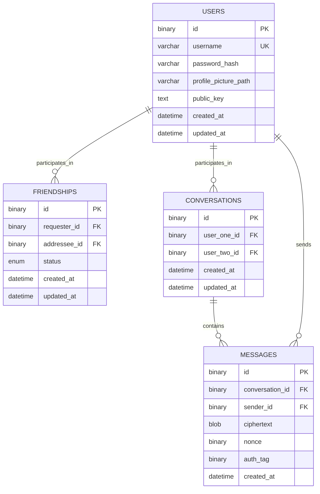

# Simplified MySQL Layout

> **Draft:** This is the initial database plan for the Seminar prototype. It
> deliberately favors a small schema over complete multi-device E2EE support.
> It should guide the first implementation but is not yet a migration.

## Initial scope

The first version uses four tables:

```text
users
friendships
conversations
messages
```

The application supports direct conversations between two accepted friends.
Messages are stored as encrypted payloads. Device-specific public keys,
conversation-key envelopes, and key rotation are deferred.

## Entity relationship diagram



## Tables

### `users`

Stores account and profile information.

| Column | Key | Purpose |
|---|---|---|
| `id` | PK | Identifies the user |
| `username` | UK | Unique public/login identifier |
| `password_hash` |  | Argon2id or bcrypt hash |
| `profile_picture_path` |  | Path or storage key, not the image itself |
| `public_key` |  | Temporary single public key for the prototype |
| `created_at` |  | Account creation time |
| `updated_at` |  | Last account update time |

Never store plaintext passwords. The single `public_key` column is a
prototype simplification; it must move to a separate device table when
Android and browser devices need independent keys.

### `friendships`

Stores requests and their current relationship status.

| Column | Key | Purpose |
|---|---|---|
| `id` | PK | Identifies the relationship record |
| `requester_id` | FK | User who sent the request |
| `addressee_id` | FK | User who received the request |
| `status` |  | `pending`, `accepted`, `declined`, or `blocked` |
| `created_at` |  | Request creation time |
| `updated_at` |  | Last status change |

The application must reject self-friendships, duplicate requests, and reverse
duplicates such as both `A -> B` and `B -> A`.

### `conversations`

Stores a direct conversation between two users.

| Column | Key | Purpose |
|---|---|---|
| `id` | PK | Identifies the conversation |
| `user_one_id` | FK | First participant |
| `user_two_id` | FK | Second participant |
| `created_at` |  | Conversation creation time |
| `updated_at` |  | Last activity time |

The application must verify that the two users are accepted friends before
creating a conversation. Store the two user IDs in a consistent order and add
a unique constraint so the same pair cannot create duplicate conversations.

### `messages`

Stores encrypted messages belonging to a conversation.

| Column | Key | Purpose |
|---|---|---|
| `id` | PK | Identifies the message |
| `conversation_id` | FK | Conversation containing the message |
| `sender_id` | FK | User who sent the message |
| `ciphertext` |  | Encrypted message content |
| `nonce` |  | AES-GCM nonce |
| `auth_tag` |  | AES-GCM authentication tag |
| `created_at` |  | Message creation time |

The backend stores encrypted payload data only. It must not store plaintext
messages, private keys, or plaintext conversation keys.

## Recommended indexes

Primary keys identify rows. Foreign keys connect rows. These secondary indexes
support common lookups:

```text
USERS
  UNIQUE (username)

FRIENDSHIPS
  INDEX (requester_id, status)
  INDEX (addressee_id, status)
  UNIQUE (requester_id, addressee_id)

CONVERSATIONS
  UNIQUE (user_one_id, user_two_id)
  INDEX (user_one_id)
  INDEX (user_two_id)

MESSAGES
  INDEX (conversation_id, created_at, id)
  INDEX (sender_id, created_at)
```

The friendship unique key prevents duplicates in one direction. Application
logic must also check the reverse direction. The conversation unique key
assumes `user_one_id` is always the lower ordered user ID.

## Authorization rules

1. A user can only read or modify their own profile.
2. Only friendship participants can view or change that friendship.
3. A conversation can be created only for accepted friends.
4. Only the two conversation participants can read or send messages.
5. The sender must be one of the conversation participants.
6. A message must be persisted before it is broadcast over WebSocket.

## Deferred features

These are intentionally excluded from the first schema:

- Separate device records and per-device public keys
- Conversation-key versions and encrypted key envelopes
- Key rotation after device revocation
- Group conversations
- Message read receipts
- Attachments
- Notifications
- Refresh-token sessions

The schema can be extended later without changing the basic relationship
between users, friendships, conversations, and messages.
