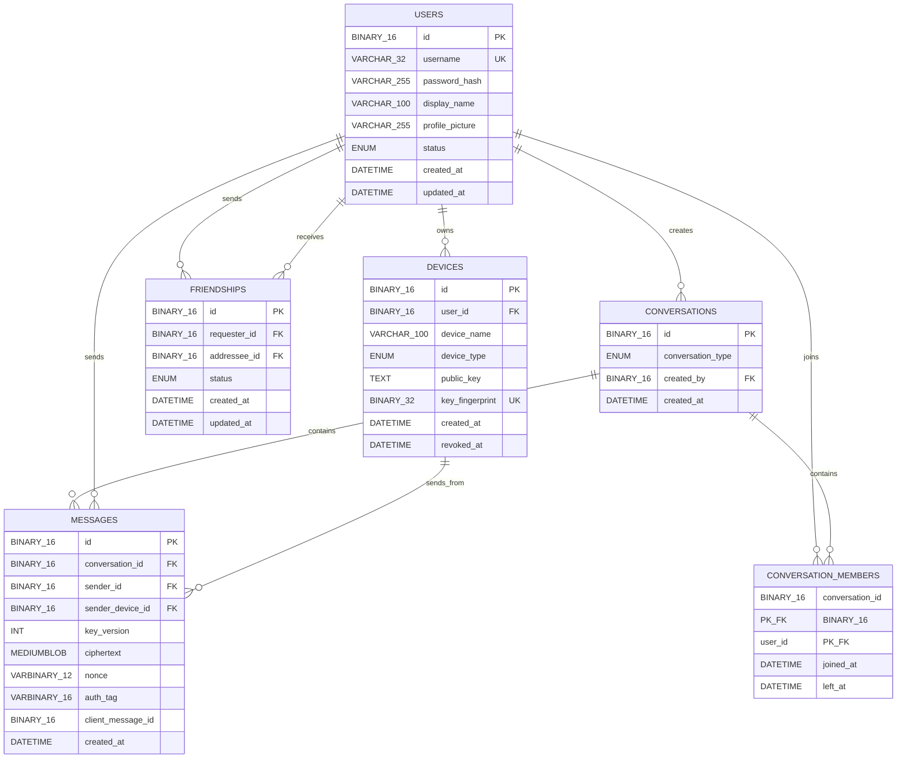

# Simple MySQL Layout

> **Draft:** This is a minimal starting layout for the chat backend. It is
> intended to make the relationships and key responsibilities clear before
> permanent migrations are written.

## Entity relationship diagram



## Key definitions

| Marking | Meaning |
|---|---|
| `PK` | Primary key. Uniquely identifies one row. |
| `FK` | Foreign key. References a primary key in another table. |
| `UK` | Unique key. Prevents duplicate values. |
| `PK_FK` | The column is both part of the primary key and a foreign key. |
| Secondary key | A non-primary index used to make searches and joins faster. |

## Relationships

- One user can own many devices.
- One user can send and receive many friendship requests.
- A conversation can have many members.
- A user can belong to many conversations.
- A conversation can contain many messages.
- A user can send many messages.
- A device can send many messages.

## Recommended secondary indexes

These are not primary keys. They support common queries:

```text
DEVICES
  INDEX (user_id)

FRIENDSHIPS
  INDEX (requester_id, status)
  INDEX (addressee_id, status)
  UNIQUE (requester_id, addressee_id)

CONVERSATION_MEMBERS
  INDEX (user_id)

MESSAGES
  INDEX (conversation_id, created_at, id)
  INDEX (sender_id, created_at)
  UNIQUE (sender_device_id, client_message_id)
```

## Important constraints

- `USERS.username` must be unique.
- `DEVICES.key_fingerprint` should be unique per user.
- A user must not be allowed to create a friendship with themselves.
- The application must prevent duplicate reverse friendships
  (`A -> B` and `B -> A`).
- Only conversation members may read or send messages.
- A message must be persisted before it is broadcast over WebSocket.
- `ciphertext`, `nonce`, and `auth_tag` contain encrypted message data only.
- No password, private key, plaintext message, or plaintext conversation key
  should be stored in MySQL.

## Deliberately deferred tables

To keep the first version simple, these are not included yet:

- Refresh-token sessions
- Conversation-key envelope history
- Message read receipts
- File metadata for profile pictures
- Group-specific roles and permissions

They can be added after the basic authentication, friendship, and messaging
flows are working.
